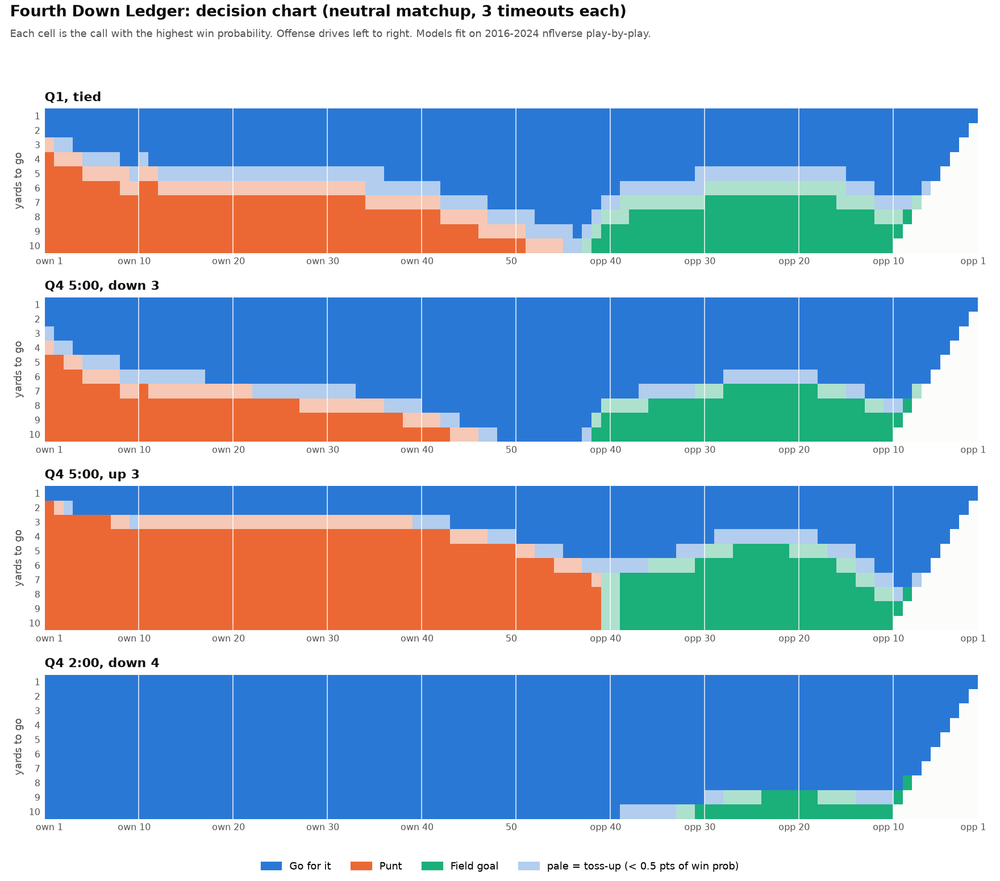
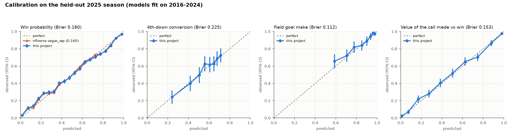

# Fourth Down Ledger

**An NFL fourth-down decision audit.** Every fourth down from the 2025 season and the 2026
season to date is priced in win probability for all three options (go for it, punt, field
goal). The ledger shows which teams and head coaches leave wins on the table, how aggressive
each staff really is once the situation is accounted for, the costliest single calls, and a
decision chart a coaching staff can print and carry.



## What it found (2025, scored out of sample)

Every pricing model was fit on 2016-2024 only, so the 2025 season is judged by models that never saw it. (The league-behaviour model behind the aggressiveness index is cross-fitted within each audited season, by design, and post-kickoff field position uses each season's own average because the kickoff rules changed.)

1. **The league left 15.2 expected wins on the table** (95% CI 12.3 to 18.6) across 3,764
   fourth downs, about half a win per team. **90% of it came from kicking when going was
   better.** On 4th & 2-3 the model says go 93% of the time; teams went 35-44% of the time. The
   costliest band was 4th & 4-5: the model says go 78% of the time, teams went 21%, and it cost
   3.6 expected wins.
2. **Houston (DeMeco Ryans) left the most: 0.79 expected wins** (0.63 to 1.00), and 0.51 even
   with the final minutes removed. It was also the most conservative staff once the situation
   is accounted for: go rate 6.7 points below what the league would do in the same spots
   (95% CI -10.2 to -2.6). Miami (0.25), Las Vegas (0.26) and Green Bay (0.29) left the least.
3. **Going for it more often is not the same as deciding well.** The rank correlation between
   the aggressiveness index and win probability lost is only -0.11 in 2025 (-0.32 in 2026 to
   date): teams can be aggressive in the wrong spots and timid in the right ones. The ledger
   scores each call, not the overall go rate.

The costliest call away from the final minutes: **Atlanta, week 17 vs the Rams, up 7 with 7:34
left, 4th & 1 at the Rams' 49, punted.** Going was worth 80.6% win probability against 73.6% for
the punt, a 7.0-point loss (95% CI 4.4 to 10.0); every bootstrap refit agrees.

2026 to date (through week 7): Indianapolis (0.42) and Denver (0.41) lead the ledger; Denver
goes for it on 7% of fourth downs, 8.9 points below expectation. Detroit is the most
aggressive staff (+12.1) and loses almost nothing outside the final minutes (0.10).


## Quick start

```bash
make all          # venv, download nflverse data (~210 MB), fit, audit, charts, site, tests
open site/index.html
```

Or step by step:

```bash
python3 -m venv .venv && .venv/bin/pip install -r requirements.txt
make data         # curl the public nflverse play-by-play releases, 2016-2026
make pipeline     # fit models, holdout metrics, audit 2025 + 2026, charts, site  (~15 min)
make test         # pytest
```

The command-line calculator uses the committed `artifacts/engine.json`, so it works straight
after cloning, without the data:

```bash
.venv/bin/python -m fourthdown recommend --ydstogo 2 --yardline 45 --score-diff -3 --qtr 4 --seconds-left 300
```

```
4th & 2 at the opponent 45, Q4 5:00, score diff -3
  GO FOR IT    37.8% win prob  <- recommended
  FIELD GOAL   27.2% win prob
  PUNT         28.8% win prob

  conversion chance 63%, field goal make chance 33%
  GO FOR IT beats PUNT by 9.0 pts of win prob (90% band +5.2 to +13.1); same call in 100% of bootstrap refits
  verdict: GO FOR IT (clear)
```

`--yardline` is the distance to the **opponent's** end zone (45 = opponent 45); `own 30` and
`opp 30` also work. Other options: `--timeouts`, `--opp-timeouts`, `--spread` (pre-game line,
positive = offense favoured), `--total`, `--home`, `--indoor`, `--receive-2h-kickoff`, `--json`.

## The dashboard (`site/index.html`)

One self-contained HTML file (plotly.js, the engine and all data inlined; works offline and on
GitHub Pages):

- **Season and team pickers** that drive every panel.
- **Decision chart**: yards to go × field position, recomputed live for any quarter, clock,
  score, timeouts and spread; pale cells are toss-ups; a print button gives a clean sheet.
- **What should they do?** calculator for any situation, with conversion and make odds, the
  margin with a bootstrap band, and how often the call survives refitting.
- **Win probability left on the table** by team with 95% intervals, the **ten costliest
  decisions** (filterable, with a switch to leave out the final minutes), sortable **team** and
  **head coach** tables, and the holdout validation with a reliability map.

The JavaScript engine is a line-for-line port of the Python one and reads the same
`engine.json`; a test checks they agree to 1e-9 on random situations.

## How it works

All four components are classical statistical models fit on **2016-2024** nflverse
play-by-play; **2025 is held out** of every fit and audited out of sample. The 2026 season to
date is audited with the same models.

| Component | Model | Data |
|---|---|---|
| Expected points | least-squares regression of the next score in the half on a 12-knot field-position spline, down, log distance and an end-of-half decay | every pre-snap state |
| Win probability (the value function) | ridge-penalised logistic regression on score margin and expected points (each also scaled by 1/√time left), Vegas line decaying with the clock, timeouts, a signed second-half-kickoff term, and late-game score-bin interactions | every pre-snap state with a final result |
| Conversion probability | ridge-penalised logistic regression: log distance, field position (quadratic), goal to go, inside the 5, a fourth-down shift and its interaction with distance, Vegas line and total, season trend | 3rd and 4th-down runs and passes |
| Yards beyond the marker | empirical distribution by distance bucket | successful conversions |
| Field goal make probability | logistic regression: linear spline in distance (knots 50 and 58 yards), roof, season trend and its interaction with distance; no kicks over 66 yards | all FG attempts |
| Punt outcome | empirical distribution of the next possession (opponent spot, muff recovery, return TD) by punt spot, pooled ±3 yards | all punts |

Then for each fourth down:

- **Go** = P(convert) × E[WP after a first down, gains drawn from the empirical distribution,
  touchdown if it reaches the end zone] + (1 − P(convert)) × WP(opponent ball at the spot).
- **Field goal** = P(make) × WP(opponent receives a kickoff, +3) + (1 − P(make)) ×
  WP(opponent ball at the spot of the kick, or its 20).
- **Punt** = average WP over the empirical next-possession distribution for that spot.
- Every change of possession flips perspective; touchdowns are 7 with the league extra-point
  rate (else 6); post-kickoff field position is measured per season (the 2024 and 2025
  kickoff rules moved it); each branch uses a fixed amount of game clock.

**WP left on the table** for a play = WP(best call) − WP(call made), both before the snap. It
scores the decision, not the outcome: a correct go that failed costs nothing.

**Uncertainty.** 200 bootstrap replicates resample whole games (plays in a game are not
independent) and refit every component, value function included, on the same resample. Each
play gets a 95% interval for WP lost and an agreement rate (share of refits that pick the same
call); team and coach totals sum the replicates, so their intervals respect the correlation
between plays.

**Aggressiveness index** = a team's go rate minus what a league-behaviour model expects in the
same situations (cross-fitted logistic regression on distance, field position spline, score
and clock), in percentage points, with a game-resampled interval.

**Use of nflverse models.** nflverse's own `vegas_wp` and `ep` columns are never model inputs;
they are only benchmarks for the win-probability and expected-points models.

## Validation (2025 holdout; models fit on 2016-2024)

| Model | Holdout score | Baseline | Calibration |
|---|---|---|---|
| Win probability, 37,305 plays | Brier 0.1597 (95% CI 0.143-0.182), log loss 0.479 | nflverse `vegas_wp`: Brier 0.1596 | slope 0.87, ECE 2.0% (nflverse: slope 0.88, ECE 1.8%) |
| Expected points | RMSE 4.45 pts vs actual next score | correlation 0.982 with nflverse `ep` | |
| 4th-down conversion, 922 attempts | Brier 0.2255 (CI 0.217-0.234) | by-distance lookup 0.2287: skill +1.4% (CI +0.1 to +2.8%); distance-only logistic 0.2294 | slope 0.96, ECE 2.7% |
| 3rd-down conversion, 7,112 plays | Brier 0.2123 | lookup 0.2141 | slope 0.99, ECE 1.0% |
| Field goals, 1,129 kicks | Brier 0.1117 (CI 0.099-0.121) | 5-yard distance bins 0.1137: skill +1.8% (CI +0.4 to +3.3%) | slope 0.93, ECE 1.6% |
| Punts, 2,000 | mean opponent start off by -0.5 yd | | predicted 90% range covers 92.1% |
| Whole chain: WP of the call actually made vs who won, 3,757 fourth downs | Brier 0.1527 | | slope 0.91, ECE 1.6% |

Calibration slopes are from a logistic recalibration (1 is perfect). Brier intervals resample
whole games. Charts: [docs/calibration.png](docs/calibration.png),
[docs/fg_curve.png](docs/fg_curve.png), [docs/punt_distribution.png](docs/punt_distribution.png).



**Reliability map.** Mean absolute gap between this project's win probability and nflverse's on
the same 2025 plays (one-score games): 2.1 points in the first half, 2.5 points from 30:00 to
5:00 left, 3.4 points from 5:00 to 2:00, and **5.4 points in the final two minutes**. Late-game
calls (Q4 under 5:00, Q2 under 2:00) are flagged everywhere, the dashboard's costliest-calls
table leaves them out by default, and every team total is also reported without them. They
are 21% of fourth downs and 22% of the win probability lost, and team rankings with and without
them correlate at 0.76 (Spearman). One hand-checked test is a recorded known failure for this
reason (down 2, 4th & 2 at the opponent 20 with 1:00 left: the model leans go; the right call
is the go-ahead kick).

**Robustness checks built in.** Each play's agreement rate (share of the 200 refits that make
the same call), 95% intervals on every play, team and coach total, and a toss-up shading on
the decision chart.


## Limitations

- No injuries, weather beyond roof type, personnel, opponent defence quality beyond the Vegas
  line, or play-call quality. A staff may know things the play-by-play does not.
- Conversion odds pool third and fourth downs (fourth-down attempts alone are a selected
  sample). The fourth-down shift is still estimated from the downs teams chose to go for, so
  conversion odds may be optimistic where teams rarely go. Together with a value function that
  rewards possession, this makes the model sit at the aggressive end of public fourth-down
  models.
- The win-probability model is a smooth regression, not a simulator. It is least accurate in
  the final two minutes of close games (see the reliability map), so late-game calls are
  flagged and every headline is also reported without them.
- Each branch is a normal play with a fixed amount of clock: no fakes, no hard counts, no
  timeouts used to set up a kick. Two-point tries are not modelled.
- Team totals are sums of probabilities (expected wins), not wins actually lost, and 2026 is a
  partial season.

## How this meets the Data Bowl requirements

| Requirement | Where |
|---|---|
| Working prototype | `site/index.html` (GitHub Pages via `.github/workflows/pages.yml`) and the `python -m fourthdown` CLI |
| Public source code (GitHub) | this repository (MIT) |
| Short description: solution, features, actionable impact | the summary at the top of this README |
| Sports analytics on a professional sport with sports data | NFL, nflverse play-by-play 2016-2026 |
| New project | built for Data Bowl 4.0 |

Judging criteria: *practical application* (decision chart, calculator, per-coach ledger),
*analytical insight* (out-of-sample validation, game-clustered bootstrap, decisions scored
pre-snap), *data presentation* (one-page dashboard, printable chart).

## Tech stack

Python 3.11, pandas, NumPy, scikit-learn (logistic regression only), matplotlib, plotly.js
(inlined), vanilla JavaScript, pytest, Make, GitHub Pages. CPU only.

## Repository layout

```
fourthdown/      data loading, features, models, engine, audit, charts, site builder, CLI
site_src/        dashboard template, styles, app and the JavaScript engine
site/            the built dashboard (index.html)
artifacts/       engine.json, metrics, per-play and per-team/coach audit tables
docs/            charts (PNG) and the printable decision chart (PDF)
tests/           pytest suite
```

Data: [nflverse](https://github.com/nflverse/nflverse-data) public play-by-play releases (see their licence and attribution terms).
Code: MIT, Copyright (c) 2026 Joshua Yeung.
